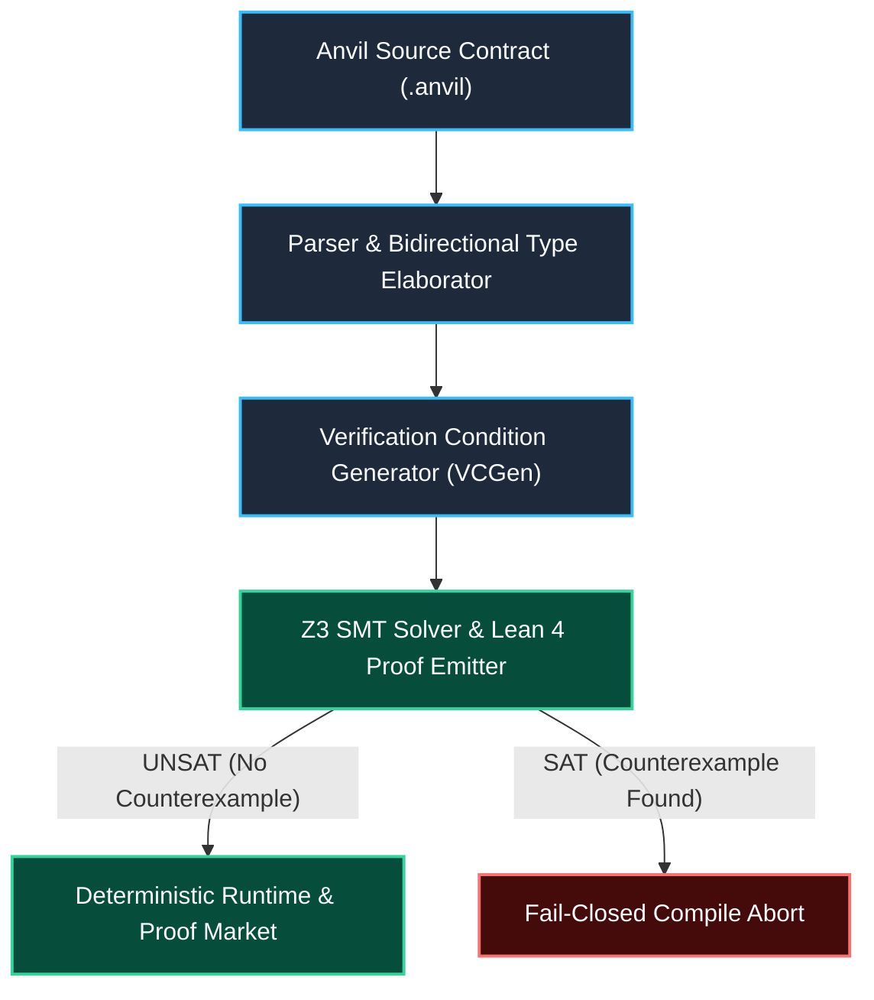

# anvil-lang

> **Formally Verified Domain-Specific Systems Language & Runtime with Z3 SMT and Lean 4 Proof Guarantees.**

[](https://github.com/borjamoskv/anvil-lang/actions)
[](./LICENSE)
[](./Cargo.toml)
[](#architecture)

`anvil-lang` is a domain-specific systems programming language designed for deterministic agent execution, cryptographic proof markets, and formal verification of computational contracts prior to runtime dispatch.

---

## ⚡ Quickstart

Run the fast verification pipeline and smoke tests directly from the repository root:

```sh
scripts/ci-quick.sh
tools/smoke.sh
scripts/ci-full.sh --list
```

---

## 🧬 Architecture & Verification Pipeline



### Key Features

- **SMT/Z3 Integration:** Automated formal verification of execution invariants and pre/post-conditions prior to runtime.
- **Type-Safe Contract System:** Prevents runtime state corruption, integer overflow, and non-deterministic side effects.
- **Zero-Anergy Memory Management:** Deterministic resource bounds with zero unnecessary heap churn.

---

## 🛠️ Local Checks & Phased CI

Run from the repository checkout; the scripts resolve the workspace from their own location. Cargo uses `target/`, shared by Anvil and `proof-market`, with one build job and no debug symbols or incremental compilation in dev/test profiles. `CARGO_TARGET_DIR` and the other Cargo environment variables remain overridable. On Apple Silicon, the default native paths use Homebrew's stable `opt/z3` and `opt/sqlite` links. Linux CI supplies its system library paths through environment variables.

```sh
scripts/ci-quick.sh
tools/smoke.sh
scripts/ci-full.sh

scripts/ci-full.sh --list
scripts/ci-full.sh --phase market-http
scripts/ci-full.sh --phase integration-soundness
scripts/ci-full.sh --from release-anvil
```

An unfiltered run executes all phases. Selected phases include their build prerequisites. Integration tests are discovered from Cargo's compiled test executable and run once each in exact-name batches, including unfamiliar names; `--batch-size` controls the maximum tests per process (default: eight).

Each run preserves output, timing, peak RSS measured with `wait4` on macOS/Linux, and exit codes in `cache/ci/`. `summary.json` identifies the last phase and overall result, while `events.jsonl` records each command's start and completion. An unfinished `running` entry means the process did not report completion. SIGKILL and SIGTERM are reported separately; a signal alone does not establish memory exhaustion. Set `ANVIL_CI_LOG_DIR` to store logs elsewhere. SaaS logs are retained and the server is stopped after the health check.

Use `scripts/clean-builds.sh --dry-run` to inspect package-scoped cleanup when needed; cache cleanup is not required before normal checks.

---

## 🛡️ License & Security

Released under the **MIT License** (see [`LICENSE`](./LICENSE)). For vulnerability reporting and formal soundness disclosures, follow the guidelines in `SECURITY.md` and `CONTRIBUTING.md`.
